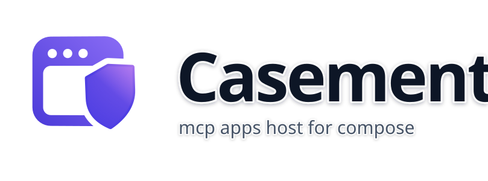

<p align="center">
  
</p>

<p align="center">
  <a href="https://github.com/jantursky/casement/actions/workflows/ci.yml"></a>
  <a href="LICENSE"></a>
</p>

# Casement

Casement turns a Compose Multiplatform app into an [MCP Apps](https://github.com/modelcontextprotocol/ext-apps) host.

An MCP server can ship a small interactive UI next to a tool: a form, a chart, a dashboard. The server declares it as a `ui://` resource, and the host shows it inside the conversation. Casement does the host side. It fetches the resource, renders it in a locked-down web view, runs the JSON-RPC bridge the app talks to, and reports everything it had to refuse.

It targets Android, iOS, the web (Wasm) and the desktop from one `McpAppView` composable, against spec `2026-01-26`.

> **Status: not released yet.** Nothing is published to Maven Central. The API can still change. Several platform claims below are only checked on an emulator, a simulator or a headless browser, and are marked as such. No real device has been used.

## Modules

| Module | What it is |
| --- | --- |
| `casement-core` | No Compose. The bridge state machine, JSON-RPC framing, tool visibility, host policy, CSP builder. Runs on every target. |
| `casement-compose` | `McpAppView` and one renderer per platform. |
| `casement-mcp-sdk` | An adapter for the official [MCP Kotlin SDK](https://github.com/modelcontextprotocol/kotlin-sdk). Optional: any other client can implement `McpAppsHostClient`. |

## Install

Not published yet. Until the first release, build from source and use `publishToMavenLocal`:

```sh
./gradlew publishToMavenLocal
```

```kotlin
dependencies {
    implementation("io.github.jantursky:casement-compose:1.0.0-SNAPSHOT")
    implementation("io.github.jantursky:casement-mcp-sdk:1.0.0-SNAPSHOT") // only with the MCP Kotlin SDK
}
```

Per-platform requirements:

- **Android**: minSdk 26. `WebViewFeature.WEB_MESSAGE_LISTENER` must be available, or the view refuses to render.
- **Web**: the double-iframe sandbox page `web-sandbox/sandbox.html` must be served from a different origin than your app. Without it the view refuses to render.
- **Desktop**: add `javafx-web` and `javafx-swing` (OpenJFX 21+) to your app. They are `compileOnly` in the library.

## Usage

With the MCP Kotlin SDK:

```kotlin
val host = connectMcpAppsHost(httpClient, "https://example.com/mcp")
val tools = host.refreshTools()            // the tools that declare a UI
val tool = tools.first()
val result = host.callTool(tool.name, arguments = null)

McpAppView(
    tool = tool,
    toolInput = null,
    toolResult = result,
    client = host,
    onMessage = { addToConversation(it.content) },
    onOpenLink = { uriHandler.openUri(it) },
    approveToolCall = { request -> askTheUser(request.name) },
    onBlocked = { log("blocked ${it.kind}: ${it.detail}") },
)
```

With another client, implement `McpAppsHostClient`: a `ToolCatalog` that knows which tools are visible to apps, `readResource(uri)` and `callTool(name, arguments)`.

`McpAppView` follows the Material 3 theme for the host context by default, so the app switches with your light and dark mode. Pass a `HostPolicy` to allow more than the defaults, which deny everything.

## Demo

`samples/demo` is a chat-like screen where the assistant answers with MCP Apps. It has a theme switch, a "Hostile app" button that runs an app doing everything it should not, and a Servers mode that connects to real ext-apps example servers.

```sh
scripts/build-fixtures.sh                          # builds the real example apps once
./gradlew :samples:demo:androidApp:installDebug    # Android
./gradlew :samples:demo:shared:run                 # desktop
./gradlew :samples:demo:shared:wasmJsBrowserDevelopmentRun   # web
scripts/run-sample-servers.sh                      # for the Servers mode
```

The iOS app is generated with XcodeGen from `samples/demo/iosApp/project.yml`.

## How it works

1. `McpAppView` reads the `ui://` resource through your client and builds a CSP from what the resource declared in `_meta.ui`, cut down by your policy.
2. The app runs in a web view the host controls. A small shim replaces `window.postMessage`, so the standard app SDK talks to the host without an iframe parent.
3. `HostBridge` is the host side of the protocol: `ui/initialize`, tool input and result notifications, `tools/call` (only for tools visible to apps), `ui/message`, `ui/open-link`, display mode and size changes, `ui/resource-teardown`. A call that breaks the rules does not reach your client. It comes back as an error and shows up in `onBlocked`.
4. The renderers refuse what the page tries on its own: navigation away, new windows, requests outside the CSP, camera, microphone and location unless the policy grants them. Each refusal is reported as a `BlockedAction`.

Android, iOS and the desktop run the app as the top-level page of a web view. The web uses a double-iframe sandbox on a separate origin.

## Prior art

- [modelcontextprotocol/ext-apps](https://github.com/modelcontextprotocol/ext-apps) defines the spec and ships the app SDK and a reference host for the web. Casement uses its real example apps as test fixtures.
- [@mcp-ui/client](https://github.com/idosal/mcp-ui) renders MCP UI resources in React.
- SwiftMCPAppHost hosts MCP Apps for SwiftUI.
- Other Kotlin work I found while searching: an MCP Apps host in http4k, and a draft pull request for a Compose bridge in the ext-apps repository. I have not tried either.

## Not covered yet

- **`window.open` is only reported on Android.** Every platform blocks the page from opening a window. Android raises a `BlockedAction` and a test asserts it. On iOS and the desktop the code has a handler, but it did not fire in my runs, and the web renderer has none.
- **Camera and microphone on iOS** are probably not exposed to a page on a custom scheme. That is unconfirmed.
- **The desktop renderer has weaker guarantees**: a meta CSP only (no header CSP), no veto of single requests, and no permission control in the engine.
- **iOS runs the shim in the page world**, not an isolated world. A hostile page could see it.
- **Teardown on dispose** sends `ui/resource-teardown` as a best effort only.
- **The CSP report for `eval` is noise.** The zod library in the app SDK probes `new Function('')`, which the strict default CSP blocks. It is harmless and shows up as a blocked `eval (script-src)`.
- No server-side rendering of a result, no streaming partial UI, and no extension beyond spec `2026-01-26` plus the draft features listed in the docs.

## Platform support

"Checked on" says where the automated tests ran. A blank means it was not run there.

| Platform | Renderer | Checked on | Security tests | Real apps |
| --- | --- | --- | --- | --- |
| Android | `WebView`, `shouldInterceptRequest`, header CSP | Emulator `tl_phone`, Android 16 (API 36), arm64 | 4 device tests | 4 ext-apps apps |
| iOS | `WKWebView`, URL scheme handler, content rules | Simulator "Casement Tests", iOS 27.2, arm64: 4 UI tests of the demo | Hostile app in the demo UI test | 1 (`get-time`) |
| Web (Wasm) | Double-iframe sandbox page | Headless Chromium through Playwright 1.57: 4 end-to-end tests of the demo | Hostile app in an e2e test | 1 |
| Desktop JVM | OpenJFX `WebView` | macOS arm64, JDK 25 | 1 test with a real window | |
| Real devices | | **not checked** | | |
| Safari, Firefox, Windows, Linux | | **not checked** | | |

The core module's unit tests run on the JVM, the Android host test, the iOS simulator and Wasm. CI runs the same suites on every pull request; see `.github/workflows/ci.yml`.

## Differences from @mcp-ui/client and SwiftMCPAppHost

These are differences in design, not a feature-by-feature comparison, which I have not done.

- Casement is one Kotlin API across four targets. `@mcp-ui/client` is React for the web, and SwiftMCPAppHost is Swift for Apple platforms.
- It implements MCP Apps (`io.modelcontextprotocol/ui`, spec `2026-01-26`) and refuses to render where it cannot enforce the sandbox, instead of rendering with weaker rules.
- The sandbox is part of the contract: every refusal is a `BlockedAction`, and each platform's tests include a hostile app.
- The core has no UI and no MCP client dependency, so you can use your own transport.

## Development

JDK 17 and the Android SDK are needed. iOS needs Xcode. Web tests need Bun and Node (versions in `.bun-version` and `.node-version`).

```sh
./gradlew spotlessCheck check koverVerify apiCheck   # the whole gate
./gradlew spotlessApply                              # format
./gradlew apiDump                                    # after changing the public API
scripts/build-fixtures.sh                            # real example apps for the conformance tests
```

Coverage gate: 90% lines and 78% branches per module. See [CONTRIBUTING.md](CONTRIBUTING.md).

## License

[MIT](LICENSE)
